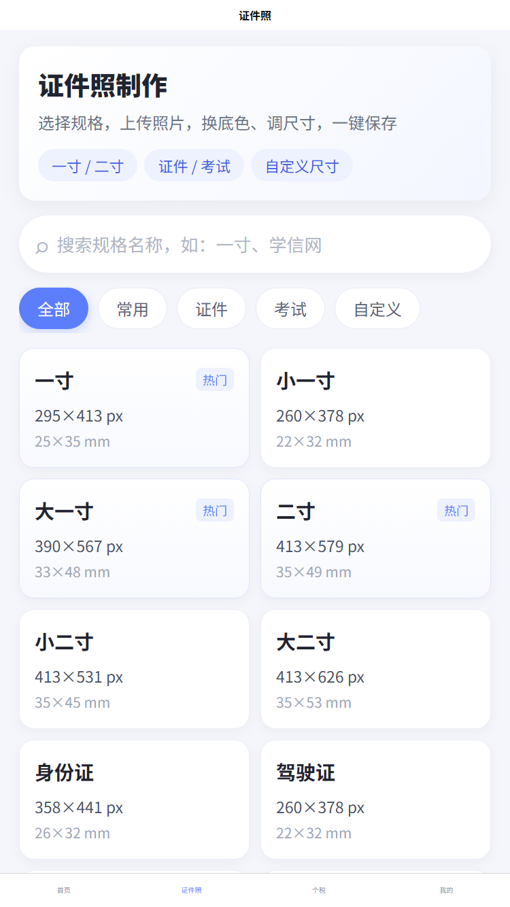

# 随身工具箱 · 证件照 + 个税（uni-app）

把两个反编译小程序合并成一个 uni-app 工具合集：

| 来源 | AppID | 合并后模块 |
|---|---|---|
| 一寸标准证件照 | `wx889d615a49330d40` | 证件照 |
| 个税计算器 | `wxaf35875a3f5dd56f` | 个税 |

技术栈：uni-app 3 + Vue 3 + Vite，同一套代码构建 H5 与微信小程序。

## 截图

| 首页 | 个税 |
|---|---|
|  |  |

| 证件照 |
|---|
|  |

## 功能

- 首页：证件照 / 个税双入口 + 快捷工具
- 证件照：规格搜索、一寸/二寸/证件/考试规格、上传照片、本机换底色、修改 KB、自定义尺寸、保存
- 个税：工资个税（月度/年度）、年终奖、劳务报酬、专项附加扣除、更多税种、结果明细、税率表
- 我的：来源说明、隐私说明、清除缓存

## 运行

```powershell
cd D:\3-Server\projects\idphoto-tax-uniapp
npm install
npm run dev:h5
```

H5 默认地址以终端输出为准（通常为 `http://localhost:5173` 或 `5174`）。

构建：

```powershell
npm run build:h5
npm run build:mp-weixin
```

微信小程序产物：`dist\build\mp-weixin`，用微信开发者工具导入。`src/manifest.json` 里的 `mp-weixin.appid` 目前是 `touristappid`，正式发布前替换成自己的 AppID。

## 目录

```text
src/
├─ pages/
│  ├─ home/                首页
│  ├─ idphoto/             证件照：列表 / 编辑 / 结果 / 改 KB / 换底色
│  ├─ tax/                 个税：首页 / 结果 / 明细 / 专项扣除 / 更多 / 通用计算
│  └─ mine/                我的
├─ tax/
│  ├─ taxEngine.js         从个税工程打包的 ESM 引擎（12 类税目）
│  └─ index.js             统一导出 taxService / taxFieldConfig / utils
├─ services/photo.js       选图、换底色、压缩、按规格裁剪、保存
├─ data/specs.js           证件照规格
├─ data/taxTypes.js        税目清单
└─ utils/format.js         金额 / 百分比 / 文件大小
```

## 个税引擎

原始计算代码来自 `D:\3-Server\outputs\wxaf35875a3f5dd56f\common`，通过 esbuild 打包为 ESM：

```text
build/tax-src/entry.cjs
  → src/tax/taxEngine.js
```

重新生成：

```powershell
D:\3-Server\projects\27-poker-bar-uniapp\node_modules\.bin\esbuild.cmd `
  build\tax-src\entry.cjs --bundle --format=esm --platform=neutral `
  --outfile=src\tax\taxEngine.js
```

支持税目：工资薪金、年终奖、劳务报酬、稿酬、特许权使用费、个体工商户、承包承租、财产租赁、财产转让、利息股息红利、偶然所得、解除劳动合同。

## 证件照处理

- 选图：`uni.chooseImage`
- 换底色：本机色键算法（边缘采样 + 颜色距离 + 羽化），适合纯色背景证件照
- 压缩：H5 用 Canvas 二分质量压缩；小程序用 `uni.compressImage` 逐级压缩
- 裁剪：按规格像素 cover 裁剪
- 保存：H5 下载；小程序保存到相册

可选接第三方抠图服务：

```powershell
$env:VITE_PHOTO_CUTOUT_URL="https://your-cutout-api.example/cutout"
npm run dev:h5
```

接口约定：`POST JSON { image: base64, bgColor }`，返回 `{ image: url|base64, width?, height?, size? }`。

## 已验证

- `npm run build:h5` 通过
- `npm run build:mp-weixin` 通过，主包约 290 KB
- 个税 12 类税目用 Node 逐项调用通过
- H5 实测：工资个税 20000 / 五险一金 3000 / 专项 2000 / 11 月 → 当月个税 1000、税后 16000
- H5 实测：合成人像 → 白底 → 295×413、8.9 KB 结果
- H5 实测：修改 KB 目标 50 KB → 实际 49 KB

## 已知限制

- 本机换底色是传统色键，不是 AI 人像分割；复杂背景/发丝边缘效果有限。
- 小程序端依赖 `wx.createOffscreenCanvas`（基础库 2.7.0+）；不支持时回退原图并提示。
- 未并入证件照的登录、订单、支付、评价、第三方 AI 接口。
- 计算结果仅供参考，最终以税务部门口径为准。
